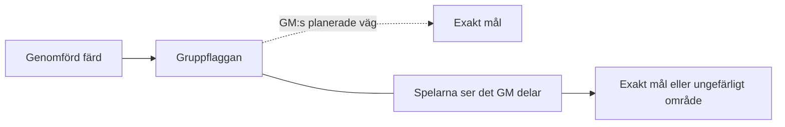

# Adventurer’s Tome – användarmanual

**Dokumenterad stabil version** är 2.1.8. **Foundry-baslinjen** är 13.351. Menynamnen följer det engelska gränssnittet. [Versionsinformation för 2.1.8](V2.1.8_STABLE_RELEASE.md)

Manualen har två delar. Den här guiden följer vanliga arbetsflöden för spelare och GM. [Fördjupningen](MANUAL-REFERENS.md) går igenom fler verktyg steg för steg och har ett [funktionsregister](MANUAL-REFERENS.md#funktionsregister) som utgår från var i Tome eller Foundry du befinner dig.

## Innehåll

- [Kom igång](#kom-igång) och [hitta rätt](#hitta-rätt-i-tome)
- [Sessions och Quests](#sessions-och-quests)
- [Gruppen, karaktärsprofiler och Token Builder](#gruppen-karaktärsprofiler-och-token-builder)
- [World, Rules och sökning](#world-rules-och-sökning)
- [Dela i chatten och styr åtkomst](#dela-i-chatten-och-styr-åtkomst)
- [Scener, kartnålar och resor](#scener-kartnålar-och-resor)
- [Spelarens krönika och påminnelser](#spelarens-krönika-och-påminnelser)
- [GM:s anteckningar och arbetsflöde](#gms-anteckningar-och-arbetsflöde)
- [Analys, länkar och alternativa namn](#analys-länkar-och-alternativa-namn)
- [Import, export och migration](#import-export-och-migration)
- [Felsökning](#felsökning) och [manualens versionshistorik](#manualens-versionshistorik)

## Kom igång

### Installera eller uppdatera som administratör

1. Gå till **Foundry Setup → Add-on Modules → Install Module**. Klistra in den [stabila manifestlänken](https://raw.githubusercontent.com/GuteboysFactory/AdventurersTome/main/channels/gold/module.json) i **Manifest URL** och installera.
2. Öppna världen och aktivera **Adventurer’s Tome** i **Manage Modules**. Öppna Tome via knappen **Adventurer’s Tome** på Foundrys arbetsyta. Frågetecknet i Tome öppnar den inbyggda snabbhjälpen.
3. Vid uppdatering av en befintlig kampanj, säkerhetskopiera världen och uppdatera modulen med samma ID, `adventurers-tome`. Starta om Foundry och ladda om spelarnas webbläsarflikar. Logga in som GM och låt **Campaign Tools → Index** arbeta klart. Befintliga kampanjer kan fortsätta med sina sparade dokument.

Foundry lagrar kampanjens Actors, Items, scener och Journals. Tome visar dessa med kampanjprofiler, länkar, sökning och verktyg kring spelkvällen. Några arbetsflöden, exempelvis innehållet på karaktärsbladet, beror på vilket regelsystem världen använder.

### Ställ in en ny kampanj som GM

1. Klicka på kugghjulet **Campaign Settings**. Under **Developer Tools → Create / Verify Folders** kan du skapa mappar för Sessions, Quests, World och Rules.
2. Öppna **Group → Manage Group**. Markera kampanjens spelarkaraktärer som **Group member**. Tilldela spelarna sina karaktärer i Foundry.
3. Gå till **Campaign Settings → Home Layout**. **Dashboard** visar bland annat senaste sessionen och aktiva quests. **Minimal** lägger fokus på kampanjbilden. **Custom** låter dig ordna och storleksanpassa innehållet med Home Builder. Kampanjens färger, bild, logotyp och navigation justeras i Campaign Settings.
4. Lägg till en session eller quest. Kontrollera vad en spelare kan läsa från ett spelarkonto innan du delar nästa spelkvälls innehåll.

### Första besöket som spelare

Öppna **Home** för senaste session, aktiva quests, gruppen och upptäckter. Använd **Sessions** för att läsa vad som hänt, **Quests** för att se uppdragets status och **My Chronicle** för egna anteckningar. Stjärnan på en post sparar en personlig favorit. Markeringarna **Q** och **S** på Tome-knappen visar att tillgängliga quests eller sessioner är olästa.

## Hitta rätt i Tome

| Jag vill… | Öppna |
| --- | --- |
| Läsa om senaste spelkvällen | **Home → Latest Session** eller **Sessions** |
| Slå upp ett namn eller en plats | **Search**, eller **World** för att bläddra bland världsposter |
| Hitta min karaktär | **Group → View Profile** eller **Sheet** |
| Se var gruppen befinner sig | **Home → Party Location** när gruppens kartposition är satt |
| Anteckna privat som spelare | **My Chronicle → New note** |
| Förbereda nästa spelkväll som GM | **Home → Next Session** eller **Campaign Tools → Assistant** |
| Leta upp ett Foundry-dokument medan jag skriver | **Campaign Tools → Quick Search** |
| Kontrollera ett namn som Tome är osäker på | **Campaign Tools → Analysis** |
| Flytta en kampanj eller säkerhetskopiera privata anteckningar | **Import & Export** och välj rätt pakettyp |

Tomes startknapp kan flyttas genom att dra den. Högerklick på knappen återställer placeringen. I fönstrets huvudrad kan du ändra hur mycket av Foundry-scenen som syns genom Tome. Minimering till startknappen sparar vyn för snabb återgång. Fönsterinställningarna är personliga.

## Sessions och Quests

### Hitta och läs en session

1. Öppna **Sessions**. Välj en mapp i **Campaign Explorer** eller välj **Show all**. Sök med **Search Sessions**.
2. Klicka på en session i listan. I ett brett fönster kan mappträdet, sessionslistan och läsytan skrollas var för sig. Fäll ihop mappträdet om läsytan behöver mer plats.
3. Läs krönikan och använd länkarna till quests, personer, platser och karaktärer. **Pages** visar sessionsdokumentets sidor när det finns flera. **Open Full Session** öppnar källdokumentet om din åtkomst tillåter det. Ändringar i en post ska kunna slå igenom medan du behåller din plats i vyn.

### Skriv eller importera en session som GM

1. Välj **New Session** för att skriva direkt och ange nummer, titel och kröniketext. Håll numren konsekventa så att sessionslänkar blir enklare att hitta.
2. Välj **Import Session** om texten finns i ett annat dokument. Kontrollera numret, titeln och förhandsvisningen. Vid uppladdning av en strukturerad rapport kan du se vilka avsnitt som hamnar i **Chronicle**, vilka som är avsedda för GM och vilka uppdrag som föreslås.
3. Läs den slutliga förhandsvisningen av krönikan innan du sparar. GM-material kan hanteras separat i **Private Vault** eller via **GM Inbox** beroende på vem som importerar. Via **Editors** kan GM ge skrivåtkomst där den finns i författarvyn. Kontrollera även mottagarens Foundry-behörighet.
4. Under sessionens kampanjlänkar kan du knyta ihop berättelsen med quests och karaktärer. Använd sessionens analys eller den fokuserade granskningen från posten när Tome behöver hjälp att tolka ett namn. Där en **Briefing** visas samlar den uppgifter och källor som hör till sessionen.
5. När texten är färdig för spelarna, välj **Show to Players**. Om uppgifterna ska avslöjas under spel väljer du **Add to Reveal Queue** och hanterar dem senare via kön.

### Skapa och ändra en quest som GM

1. Öppna **Quests → New Quest** eller importera en förberedd quest. Skriv en tydlig titel och ett mål. Lägg in källor, relevanta världsobjekt och karaktärer när de behövs.
2. Öppna questen och använd den lilla statusmenyn ovanför titeln. **Active** är pågående, **Dormant** är vilande, **Completed** är slutförd och **Failed** är misslyckad. När du väljer **Active** hör questen hemma bland aktiva quests och kan visas på Home för användare som har åtkomst.
3. Komplettera med ett resultat eller en uppdatering när läget ändras. Under **Campaign Links** kan spelarna följa sambandet mellan questen och krönikan. GM kan lägga till en Actor via **Quest Characters → Link Character**.
4. Kontrollera vem som ska se questen. En personlig quest behåller sin valda mottagarkrets. En delad quest kan visas för gruppen enligt sin åtkomst.

## Gruppen, karaktärsprofiler och Token Builder

**View Profile** öppnar Tomes kampanjprofil med exempelvis biografi, publika fakta, relationer och kampanjlänkar. **Sheet** öppnar Foundrys karaktärsblad och styrs av Actor-åtkomst. GM kan lägga till profilknappar till exempelvis ett Foundry-dokument eller en webblänk.

När GM markerar en spelarkaraktär som **Group member** kan Tome ge gruppens spelare begränsad Foundry-åtkomst till den publika profilen och skapa **Party Member**-kopplingar. Ett aktivt GM-konto synkroniserar gruppen. Det går att läsa den publika profilen med begränsad åtkomst medan hela karaktärsbladet kräver sin egen behörighet.

### Ändra bild på en karaktär du får redigera

1. Öppna karaktärsprofilen i Tome och välj porträttredigeringen. Du kan även klicka på porträttet i Foundrys karaktärsblad eller släppa en bildfil på det för att öppna Tomes **Portrait Editor**.
2. Lägg in källbilden och justera beskärningen. Välj den bild du vill se i **Full artwork**, **Portrait** eller **Token image**. Hovra över bilden i **Group** eller på bladet för att visa tillgängliga bildval. Skapa eller redigera själva bilden i profilen eller bildredigeraren.
3. För en karttoken kan du välja form och ramens struktur var för sig. Under **Customize frame** kan du välja färger och justera tjockleken inåt och utåt separat. Använd **Outer thickness** för att bredda ramen utanför bilden. Du kan också välja en bild utan ram eller en animerad effekt som sken, eld, frost eller gnistor.
4. Spara och kontrollera bilden i **Group**, på **Home** och på Foundrys karaktärsblad. När en tokenbild sparas uppdateras prototypen och spelbara kartkopior där du har behörighet. Avmarkera alternativet att ersätta egna tokenbilder om befintliga kartkopior ska behålla sin särskilda bild.
5. Nya tokens håller bilden upprätt som standard. Justera den enskilda tokenens rotationsinställning när motivet ska rotera med tokenen.

### Packdjur, basförråd, kistor och lådor

1. Öppna **Group → Storage**. Välj **New storage** och typ, till exempel packdjur, hem eller bas, kista, låda, tunna eller annan behållare. Med **Use existing Actor** kan du använda ett befintligt packdjur. Använd **Configure access** för att välja vilka spelare som får använda förrådet.
2. Öppna karaktärsbladet och **Inventory & Gear → Storage…**. Välj förråd och dra föremålet från bladet till listan. För att ta tillbaka det drar du från listan till **Drop item from storage here**. Ett föremål med antal flyttas som en stapel.
3. För att flytta föremål behöver spelaren ägarbehörighet för både karaktären och förvaringen. **Observer** kan läsa listan. Om förvaringen finns på kartan kan dess tokenkontroller visa **Open storage**.
4. Om en redan packad bärbar Realm Guard-behållare behöver flyttas till ett annat inventarium, flytta först ut innehållet och flytta sedan behållaren.

## World, Rules och sökning

### Lägg till och använd en världspost

1. Öppna **World**. Välj mapp eller sök på namn. Du kan ändra hur många poster som visas åt gången. **Show more** laddar nästa grupp, och sökningen täcker även tillgängliga poster längre ned.
2. Som GM använder du mappens åtgärder för att skapa en post eller koppla ett befintligt dokument där den åtgärden finns. Välj typ, exempelvis **NPC**, **Location**, **Faction**, **Item** eller **Lore**. Kontakter kan också visas som egna poster.
3. Öppna posten och redigera **Known Information** där du har skrivrättighet. Flera Journalsidor kan visas i ordning, till exempel text, bild, video eller PDF. Länka en Actor för ett NPC-blad där det behövs.
4. Använd **Release player information…** när du vill dela mer om en NPC. En NPC som länkas från en delad session kan få ett kort med namn och porträtt med begränsad åtkomst. Biografi och statistik har separata åtkomstkrav.

World kan visas med ursprunglig mappstruktur, innehållsindelning eller egen struktur. En kopierad struktur kan ordnas i Tome utan att de länkade Actors eller Items flyttas i Foundry. GM kan tilldela **World Editor** för en specifik post, så att en spelare kan redigera den spelarvända texten med rätt Foundry-behörighet.

### Bygg en regelreferens

Öppna **Rules** och sök bland kampanjens regler. GM kan använda **New Rule → Create Rule** för en ny husregel, eller **Link Existing** för en Foundry Journal som redan finns. Sidorna visas i ordning. Markera en relevant paragraf om du vill hänvisa till den i chatten.

### Välj rätt sökning

- **Search** söker bland de kampanjposter du kan läsa. Filtrera om du exempelvis enbart vill se personer eller quests. Tryck **/** när du står utanför ett textfält för att gå till sökningen.
- Sökfältet i en flik håller dig i den typen av innehåll. **Favorites** och **Recently Viewed** följer ditt eget konto.
- **Quick Search** kan leta efter tillgängliga Foundry-dokument i världen och Compendiums, öppna källan och infoga en referens där verktyget erbjuds. GM kan också använda stödda åtgärder för placering på kartan.
- **Campaign Tools → Memory** är GM:s arbetsvy för iakttagelser, samband och källor från kampanjanalysen. En träff här kan ha en annan status än en publicerad världspost.

## Dela i chatten och styr åtkomst

### Skicka ett utdrag, en bild eller en post

1. Markera den text du vill skicka i en Tome-vy eller ett Foundry-dokument. Använd **Send to Chat** eller **Whisper…** i verktyget som visas. För kompatibla bilder eller tabeller kan motsvarande delningsåtgärd visas när du väljer innehållet. Funktionen fungerar även när Tome-fönstret är stängt, så länge modulen är aktiverad.
2. Granska vad som ska skickas. Välj offentlig chatt eller mottagare. Mottagarnas åtkomst till dokumentet och sidan kontrolleras för källbundna länkar och utdrag.
3. För hela posten använder du **Send to Chat** där åtgärden visas. En Tome-ögonblicksbild av en post visar spelarvända fält enligt delningsläget. Om du istället skickar en källänk behöver mottagaren kunna öppna källan.
4. Vill du styra porträtten i din chatt, öppna **Configure Settings → Adventurer’s Tome** och välj **Show speaker portraits in chat**, form och storlek. När GM talar som sig själv kan **Chronicler** visas. När någon talar som en synlig token kan tokenens bild visas för spelarna.

Använd **Speak as** vid Foundrys chattfält för att söka fram en karaktär att prata som. GM börjar som **Gamemaster** och kan återgå till det läget från väljaren. Spelare kan välja bland karaktärer som är kända för dem. Chattens NPC-namn följer vad GM har gjort känt för mottagaren.

### Kontrollera åtkomst som GM

Foundry **Ownership** avgör vilka användare som får öppna källdokumentet. **Discovered** och **GM-only** avgör sedan hur det visas i Tome. För innehåll som ska vara hemligt även i Foundry, begränsa också källans Foundry-åtkomst. Lägg privata arbetsanteckningar i din egen Vault.

- **World:** kryssa i önskade kort. Hovra över ett kort för en åtkomstöverblick, eller välj **Who can see?** för de markerade posterna. **Review Selected** öppnar granskningen inför ändring.
- **Foundrys sidopaneler:** använd **Select entries** där Tome visar verktyget och välj dokument. **Who can see?** och **Review access** granskar behörigheter. Det finns även åtgärder för att flytta, exportera JSON och radera de valda dokumenten. Läs listan i bekräftelsen innan du gör en ändring.
- **Campaign Tools → NPCs, Contacts & Items:** sök och filtrera listan efter typ eller undertyp, välj posterna och granska deras Foundry-ägarskap. Använd vyn när du exempelvis vill ge samma spelare läsrätt till flera NPC-poster eller föremål. **Undo** kan återställa den senaste stödda åtkomständringen.
- **En enskild Tome-post:** använd **Tome permissions** där knappen visas. **Show to Players** är åtgärden för att aktivt visa material. **Reveal Queue** låter dig förbereda avslöjandet vid ett senare tillfälle.

## Scener, kartnålar och resor

### Byt scen för dig själv med Compact scenes

Öppna **Scenes…** från kartans högerklicksmeny eller **GM Dock → Tools** för att söka, bläddra i mappar och lägga till favoriter. **Open for me** öppnar scenen för dig själv. Som GM kan du välja **Activate for everyone** för att byta scen för bordet. Använd **Create scenes from images…** för att välja filer eller släpp en bild på **Create scene here**.

1. Titta på **Foundrys spelkarta**, där Foundry brukar visa scenernas namn. Klicka **Compact scenes** i den scenlisten. Hittar du inte knappen kan du slå på **Configure Settings → Adventurer’s Tome → Compact scene navigation**.
2. Den vanliga scenlisten ersätts av rullistan **Open scene for me…**. Välj en scen under dess Foundry-mapp. Scener utan mapp ligger under **Unfiled**. **Active** markerar scenen som är aktiv för bordet.
3. När du väljer en scen byter du bara din egen kartvy. Vill du som GM flytta hela bordet använder du Foundrys **Scenes**-sidopanel, högerklickar på scenen och väljer **Activate**. Klicka **Standard scenes** om du vill ha tillbaka den vanliga listen. Varje användare väljer sitt eget läge.

Som GM använder du **Scenes → högerklicka på scenen → Scene access…** för att tillåta eller dölja en scen per spelare. Aktivera även **Show in Navigation** på scenen om spelarna ska kunna öppna den själva. Foundry visar den aktiva scenen för bordet.

### Förval för nya scener

1. Öppna **Scenes → Settings… → Set defaults or update existing scenes…** som GM. Välj rutnät, rutstorlek, bredd, höjd, bakgrundsfärg, tokensyn och global belysning.
2. Kryssa i **Apply saved defaults to new scenes** och klicka på **Save defaults** för att använda de sparade värdena på nya scener.
3. För befintliga scener, kryssa i **Apply to existing** bredvid fälten du vill ändra. Välj **Apply to existing scenes…**, markera alla eller välj enskilda scener och granska ändringen innan du bekräftar.
4. För att göra ett undantag på en enskild scen, öppna dess vanliga Foundry-inställningar och spara där.

### Placera en nål eller länka en scen

1. Som GM högerklickar du där nålen ska stå på kartan och väljer **Create item / place on map…**. Välj ett befintligt dokument när det finns, eller skapa en plats, anteckning eller föremål för kartan. Välj symbol, storlek och synlighet. En plats kan visas som en tom ring och en anteckning som pergament.
2. Högerklicka på nålen och välj **Edit marker** för att ändra den. Du kan välja nålens bakgrund eller använda kartans stil under **Map pin appearance** i modulinställningarna.
3. Välj **Link scenes…** från nålens meny. Sök på scennamn, kryssa i en eller flera scener och klicka på **Save scene links**. Använd **Manage scene links…** för att lägga till eller ta bort scener senare. Sessions, Quests och World kan också knytas till en scen från den aktuella posten.
4. För att placera en Actor använder GM kartans **Place existing NPC or PC…**. Spelare kan ta bort sin egen tilldelade token via tokenkontrollerna när åtgärden finns. Actor-dokumentet finns kvar.

När gruppen når nålen får GM välja en av de länkade scenerna. **Preview for me** öppnar den i GM:s egen vy. **Activate for players…** byter scen för bordet efter bekräftelse. Du kan öppna listan igen via **Open linked scenes…** på nålen eller gruppflaggan när den står där.

### Börja resan och ge en spelare flaggan

1. Högerklicka på en kartnål och välj **Set party position**. Det placerar gruppflaggan på kartan. **Home → Party Location** öppnar kartan vid flaggan och kan visa att gruppen är mellan två platser.
2. Högerklicka på flaggan och välj **Who can move this flag?**. Välj spelaren och klicka **Save**. Spelaren kan sedan dra flaggan på en tillgänglig karta. För att återta kontrollen välj **GM only**.
3. Välj **Open Travel Planner…** om du behöver delmål, planering eller händelser. Aktivera planeraren för resan och välj en **Session log** om du vill knyta resan till en session. Spara inställningarna.

### Delmål, fri väg och vad spelarna ser

1. Högerklicka på en nål och välj **Set final destination**. Använd **Add waypoint** på nålar ni ska passera. Delmålen läggs till före slutmålet.
2. I fri färd kan GM justera nästa vägsträcka genom att dra den mot en waypoint. Högerklicka på kartan och välj **Draw route from flag…** för att rita en sträcka som följer kartans väg. Gruppen kan också gå fritt med flaggan. Linjen bakom flaggan visar var gruppen faktiskt har varit.
3. Som GM väljer du om slutmålet ska vara dolt, visas exakt eller endast som område. För ett dolt exakt mål med ett synligt område, högerklicka på flaggan och välj **Draw approximate goal area…** och dra ut cirkeln. **Set and share exact goal** på nålen eller **Share exact goal** på flaggan visar det exakta målet. **Hide goal from players** döljer målet igen.
4. I fri färd ser spelarna flaggan och den färdväg som redan har tagits samt det mål GM har delat. GM kan dessutom se sin planerade väg mot målet. När gruppen lämnar en waypoint tonas äldre sträckor ned, medan den aktuella sträckan syns tydligare.

### Händelser, delat sällskap och historik

- Högerklicka på markören och välj **Add / edit marker event…** i fri färd, eller motsvarande händelseval i planeraren. Lägg till en encounter, en kontroll eller annan händelse och välj en scen om du vill. När gruppen når händelsen kan GM öppna den, förhandsvisa eller aktivera scenen, välja en avstickare eller fortsätta på samma karta. Händelsens förberedelser hålls privata för GM.
- Använd **Split party…** från flaggans meny när gruppen delas. Bestäm vilka som går tillsammans och vem som får flytta respektive flagga. När flaggorna uppfyller villkoren för återförening visas **Rejoin** i menyn. De färdvägar som redan har tagits finns kvar.
- Vid en felaktig flytt, högerklicka på flaggan eller kartan och använd menyvalet för att ångra. **Manage travel routes…** visar äldre resor och sträckor. GM kan markera och ta bort flera ej länkade poster när de kan tas bort. Både GM och spelare kan färgmarkera äldre sträckor för egen del.
- Arkivera efter avslutad resa när **Finish journey** visas. Öppna **Travel History** från **Campaign Tools**, en länkad **Session** eller **My Chronicle**. Historiken utgår från genomförd resa. Spelarna får de sträckor och uppgifter de har rätt att se.

## Spelarens krönika och påminnelser

1. Öppna **My Chronicle → New note**. Skriv en rubrik och anteckning. Sök efter en länkad person, plats eller post om det hjälper dig hitta tillbaka. Ange ett datum om minnet ska visas under **Remembered moments**.
2. Växla mellan **My notes**, **Remembered moments** och **Known to me**. **Known to me** sammanställer personer och platser ur anteckningar du får se. Det är din spelbild och kan innehålla obekräftad information.
3. När du vill dela, välj **Share with GM…** eller **Share with Party…** och kontrollera den sparade versionen i förhandsvisningen. **Withdraw shared versions** drar tillbaka delningen i Tome. Mottagare kan ha sparat en egen kopia.
4. Via **Remind me** på en anteckning kan du sätta en privat påminnelse. Påminnelser kan bland annat kopplas till tid eller scen och senare skjutas upp eller markeras klara. My Chronicle har en egen **Import & Export** för din krönika och kan ha eget krypteringslösenord.
5. GM ser uttryckligen delade anteckningar i **Campaign Tools → Player Signals**, till exempel per spelare. De kan användas som underlag för en scen eller uppföljning.

## GM:s anteckningar och arbetsflöde

| När | Använd |
| --- | --- |
| Före spel | **Next Session** för aktiva uppdrag, förberedelser, förfallna anteckningar och vad som väntar på att visas |
| Under spel | **Quick Capture** för nya namn, rykten, följder eller idéer. **Reveal Queue** för planerade avslöjanden |
| Efter spel | **Post-Session Assistant** för öppna trådar, anteckningar, avslöjanden och nästa steg |
| För löpande skrivande | **GM Notes** för Notebook, Scratchpad, privata notepad-sidor och anteckningsflödet |
| För källknutna privata anteckningar | **Campaign Tools → Private Vault**, dokumentets låsikon eller tokenens **GM Notes** |

I **Campaign Settings → GM Notebook → Customize Workspace** kan du välja en layout, dra paneler i handtaget, ändra bredd och visa tidigare dolda paneler. Anteckningarna finns kvar när layouten ändras.

### Öppna Private Vault direkt i skrivläge

1. Markera en token och välj **GM Notes** bland dess tokenkontroller. Alternativt använd kortkommandot **Write Private Vault note** under **Configure Controls**. Standard använder **Ctrl** tillsammans med tangenten för **<** på nordiskt tangentbord. Du kan ändra kombinationen i Foundry.
2. Skriv direkt i redigeraren. Använd rubrik, kategori och fästmarkering om de hjälper dig hitta den senare. Du kan bifoga en bild när du behöver den.
3. Hovra över en token eller en kompatibel kartmarkör för en privat förhandsvisning när anteckning finns. Öppna **Private Vault** för sökning eller för att visa hela anteckningen.
4. Vid delning väljer du det utdrag eller den bild som ska skickas och till vilka. **GM Inbox** tar emot skyddade delar från behöriga importörer. Öppna mottagarens Vault minst en gång för att förbereda inkorgen och granska innehållet innan det tas in.

Nya GM-valv använder normalt Foundrys kontoåtkomst. Valvet hör till ditt GM-konto, och en administratör med tillgång till serverfilerna kan läsa data i kontoläge. Äldre krypterade valv behåller sin kryptering. Sparade extranycklar för chattviskningar kan vara bundna till webbläsarprofilen. Behåll lösenord, backup och den mottagande profilen om du behöver läsa äldre innehåll. [Detaljer om Vault och säkerhetskopior](V2.1.2_STABLE_RELEASE.md)

## Analys, länkar och alternativa namn

Tome använder källtexter, tillgängliga kampanjposter, Foundry-identiteter och tidigare beslut för att föreslå länkar. En Actor och en länkad Tome-profil kan vara samma identitet. Om det också finns en likadan NPC utanför World prioriteras World-posten när analysen bedömer att det rör sig om samma namn. Flera skilda World-identiteter kan fortfarande behöva granskas. Kompendiemallar hör till Quick Search, och valda världsbibliotek kan ge underlag till analysen.

### Hjälp Tome välja rätt

1. Öppna **Campaign Tools → Analysis** för alla beslut, eller öppna granskningen från en viss session eller quest. Klicka på **Source** för att läsa sammanhanget.
2. Kontrollera kandidaternas namn, typ, tidigare länkar och källan. Om den rätta finns välj **This is the one**. Det sparar normalt den bekräftade formen för kampanjen. Kryssa i **Only remember this name for this source** om sammanhanget är ett undantag.
3. Använd **Link existing** om rätt identitet behöver letas upp. Om texten verkligen introducerar en ny person, plats eller grupp kan GM skapa en ny identitet. Välj **Save as rumour…** för en obekräftad uppgift eller **Keep unresolved** när den behöver vänta.
4. För att lära Tome namnen direkt, öppna posten i **World** eller karaktärens profil i **Group** och välj **Alternative names**. Lägg exempelvis in *Edrik* och *Kråkan* på Edrik ”Kråkan” Törne, och *Svarta Hjälmarna* på Kullfolket om namnen syftar på samma grupp. Efter bekräftelse kan analysen även hantera former som *Edriks*.
5. Om en träff fortsätter återkomma, kontrollera **Matching preferences**, den faktiska källan och tidigare sessionslänkar. Använd **Undo** för det senaste beslutet när funktionen erbjuds. När två skilda identiteter delar ett alias behöver Tome ett beslut där sammanhanget är oklart.

**Memory** visar sådant Tome har hittat och var det kommer ifrån. **Index** visar analysens status och kan användas för att se om ändringar har bearbetats. På en identitet kan **Review source facts** visa föreslagna fakta och deras källor. Godkänn en relation eller källuppgift först när källan ger stöd för den.

### Undersök språkstödet som GM

Öppna **Language Lab** från sessions- eller questverktygen. Välj källa och **Auto**, **Swedish** eller **English**, klicka **Inspect this source** och läs vilka ledtrådar Tome använde. Språkstödet körs lokalt även i den vanliga analysen. I labbet kan du också importera eller ta bort egna kampanjreferenser. Ett valt världsbibliotek kan hjälpa med namn och platser, medan kampanjens källor avgör vad som faktiskt har hänt.

## Import, export och migration

### Importera en rapport eller ett Tome-paket

1. Öppna **Import & Export** från Tomes verktygsmeny. Välj importtyp, till exempel session, quest eller Tome-paket. Från **Sessions → Import Session** kommer du direkt till sessionsflödet.
2. Ladda upp eller klistra in innehållet. Läs förhandsvisningen och bestäm vilka poster som ska skapas, uppdateras eller hoppas över. Kontrollera identitetslänkar, avsnitt för GM och eventuell målgrupp.
3. Kör importen och öppna resultatet. En betrodd spelare eller assisterande GM med Foundry-rätt att skapa Journals kan importera vissa dokument. Materialet startar med begränsad åtkomst och skyddade delar skickas via den avsedda GM-vägen. Om delningen väntar på GM kan den behöva slutföras från en aktiv GM-klient.
4. **Undo Last Import** gäller den senaste stödda Tome-importen. För en återställning av hela världen använder du den vanliga Foundry-backupen.

### Flytta till en annan värld

1. Exportera ett kampanjpaket från källvärlden. Säkerhetskopiera båda världarna.
2. Öppna paketet i destinationsvärlden. Granska dokumenttyper, spelarkonton, ägarskap, mappar, medier och länkar innan du godkänner kopiorna. Kontrollera rapporten för sådant som inte gick att mappa.
3. Vid konvertering använder du en verifierad adapter för käll- och målsystem. TAF 3.1/3.2 till Realm Guard är ett dokumenterat exempel. Okända regler eller fält kan ligga kvar som källunderlag. Vid brutna kontaktlänkar kan GM matcha varje roll med rätt identitet.
4. Vid avbrott granskar du vad som redan har sparats och fortsätter via importflödet. Källvärlden finns kvar, så du kan jämföra kopiorna mot originalen. [Migreringens omfattning och stöd](V1.9_STABLE_RELEASE.md)

| Export | Välj när |
| --- | --- |
| **Portable Package** | Du vill kunna importera materialet i Tome igen |
| **Player-safe Package** | Du vill dela kampanjmaterial avsett för spelarna |
| **Full GM Archive** | Du behöver ett privat GM-arkiv. Filen kan innehålla hemlig information |
| **Export GM Notes & Vault** | Du vill flytta eller säkerhetskopiera ditt GM-kontos anteckningar och Vault separat |
| **Export my Chronicle** | Du vill flytta eller säkerhetskopiera dina egna spelaranteckningar |

För system- eller modulutvecklare finns det separata kontrakt för [Integration API](INTEGRATION_API.md). Vanlig installation och användning av Tome kräver ingen egen adapter.

## Felsökning

| Symtom | Kontrollera |
| --- | --- |
| En spelare ser en tom lista eller saknar en post | Kontrollera **Who can see?**, källdokumentets Foundry-ägarskap, upptäcktsstatus och om posten är GM-only. Kontrollera målgruppen om det är en personlig quest. |
| En quest syns inte bland aktiva på Home | Öppna questen, kontrollera **Active** och att spelaren får se posten. Kontrollera även att **Active Quests** visas i din Home-layout. |
| Samma namn dyker upp flera gånger | Öppna källan och jämför kandidaternas identiteter. Kontrollera World-länken till rätt Actor, sparade alias och **Matching preferences**. Låt indexet arbeta klart efter en uppdatering. |
| Flaggan går inte att dra som spelare | GM behöver tilldela dig via **Who can move this flag?**. Kontrollera att du är på rätt scen och att en väntande resehändelse har hanterats. |
| Spelaren ser flaggan men ingen väg framför den | I fri färd visas den väg gruppen har tagit och det mål GM har valt att visa. GM:s vägledning framåt finns på GM:s karta. |
| En bild skiljer sig mellan Home och bladet | Kontrollera att det är samma karaktär och att rätt bildläge är valt. Kontrollera vid karttoken om en egen tokenbild har behållits, eller om ditt konto saknar rätt att uppdatera den placerade tokenen. |
| GM ser chattporträtt men en spelare gör det inte | Kontrollera spelarens **Show speaker portraits in chat**, att spelarklienten har den uppdaterade 2.1.7 och att talarens token är synlig när porträttet ska hämtas därifrån. |
| En privat anteckning verkar saknas | Kontrollera vilket GM-konto du är inloggad på och vilket valv du öppnat. Kontrollera **GM Inbox** om anteckningen kom via import. |
| Länkar är brutna efter omorganisation eller migration | Öppna **Campaign Settings → Developer Tools → Tome Health Check**. Kontrollera saknade mål, dubblettnummer och föråldrade länkar. **Repair Safe Issues** kan rensa länkar som går att bekräfta som föråldrade. Granska tvetydiga poster manuellt. |

## Manualens versionshistorik

| Version | Dokumentation |
| --- | --- |
| **2.1.8** | Uppdaterad guide för scenförval, scenimport, massändring, scenlänkar, chatt, förvaring och Token Builder. |
| **2.1.7** | Svensk användarguide och fördjupning med funktionsregister. Inkluderar den publicerade uppdateringen för chattporträtt och vem som får flytta gruppflaggan. |
| **2.1.7-qa.20** | Separata provsteg för nya scenförval och delad förvaring. |

Manualens uppdatering inför varje publicering beskrivs i [releaseprocessen](GITHUB-RELEASE.md#manualen-vid-varje-publicering).
