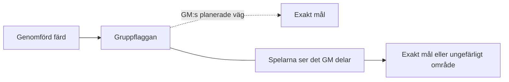

# Adventurer’s Tome – användarmanual

**Dokumenterad stabil version** är 2.1.10. **Foundry-baslinjen** är 13.351. Menynamnen följer det engelska gränssnittet. [Versionsinformation för 2.1.10](V2.1.10_STABLE_RELEASE.md)

[English](MANUAL-EN.md) · [Svensk fördjupning](MANUAL-REFERENS.md)

## Innehåll

Välj vad du vill göra. Länkarna går direkt till instruktionerna. Du kan öppna den sökbara manualen via frågetecknet i Tome. Där kan du välja språk och filtrera på **Snabbguider**, **Tutorials** eller **Uppslagsverk**.

| Område | Guider |
| --- | --- |
| **Kom igång** | [Installera eller uppdatera](#installera-eller-uppdatera-som-administratör) · [Ställ in en ny kampanj](#ställ-in-en-ny-kampanj-som-gm) · [Första besöket som spelare](#första-besöket-som-spelare) · [Startknapp och fönster](#startknapp-och-fönster) |
| **Sessioner, quests och anteckningar** | [Läs senaste sessionen](#hitta-och-läs-en-session) · [Skriv eller importera en session](#skriv-eller-importera-en-session-som-gm) · [Skapa en quest eller ändra status](#skapa-och-ändra-en-quest-som-gm) · [Använd My Chronicle](#spelarens-krönika-och-påminnelser) · [Skriv en privat GM-anteckning på en token](#öppna-private-vault-direkt-i-skrivläge) · [Förbered nästa spelkväll](#gms-anteckningar-och-arbetsflöde) |
| **Scener och kartan** | [Öppna en scen eller flytta spelarna](#öppna-scener-och-flytta-gruppen) · [Använd Compact scenes](#byt-scen-för-dig-själv-med-compact-scenes) · [Skapa scener från bilder](#skapa-scener-från-bildfiler) · [Spara scenförval eller massändra scener](#förval-för-nya-scener) · [Placera en kartnål eller länka en scen](#placera-en-nål-eller-länka-en-scen) |
| **Gruppflagga och resor** | [Sätt gruppens plats och ge en spelare flaggan](#börja-resan-och-ge-en-spelare-flaggan) · [Rita vägen och välj vad spelarna ser](#delmål-fri-väg-och-vad-spelarna-ser) · [Lägg till en händelse, dela gruppen eller läs resehistoriken](#händelser-delat-sällskap-och-historik) |
| **Karaktärer, bilder och förvaring** | [Hitta gruppen och karaktärsbladet](#gruppen-karaktärsprofiler-och-token-builder) · [Byt porträtt eller helbild](#ändra-bild-på-en-karaktär-du-får-redigera) · [Bygg en karttoken med ram](#skapa-en-karttoken) · [Håll tokenbilden upprätt](#håll-tokenporträttet-upprätt) · [Flytta föremål mellan karaktär och förråd](#packdjur-basförråd-kistor-och-lådor) |
| **Chatt, åtkomst och dokument** | [Skicka ett utdrag eller en viskning](#skicka-ett-utdrag-en-bild-eller-en-post) · [Välj vem som talar och visa tokenporträtt](#visa-tokenporträtt-och-välj-vem-som-talar) · [Se vem som har åtkomst och ändra den](#kontrollera-åtkomst-som-gm) · [Markera, flytta eller exportera flera dokument](#arbeta-med-flera-foundry-dokument) |
| **World, regler och analys** | [Skapa eller öppna en World-post](#lägg-till-och-använd-en-världspost) · [Bygg en regelreferens](#bygg-en-regelreferens) · [Välj mellan Search och Quick Search](#välj-rätt-sökning) · [Granska en identitetsmatchning och spara alternativa namn](#hjälp-tome-välja-rätt) · [Undersök språkstödet](#undersök-språkstödet-som-gm) |
| **Import, felsökning och uppslagsverk** | [Importera en rapport eller ett paket](#importera-en-rapport-eller-ett-tome-paket) · [Flytta en kampanj mellan världar](#flytta-till-en-annan-värld) · [Felsök ett problem](#felsökning) · [Slå upp en tidigare Foundry-modul](MANUAL-REFERENS.md#gm-verktyg-efter-modulnamn) · [Öppna fördjupning och funktionsregister](MANUAL-REFERENS.md) · [Se manualens versionshistorik](#manualens-versionshistorik) |

## Kom igång

[Till innehållet](#innehåll)

### Installera eller uppdatera som administratör
<!-- tome-manual install|guide|gm|installera add-on modules manifest update uppdatering -->

1. Gå till **Foundry Setup → Add-on Modules → Install Module**. Klistra in den [stabila manifestlänken](https://raw.githubusercontent.com/GuteboysFactory/AdventurersTome/main/channels/gold/module.json) i **Manifest URL** och installera.
2. Öppna världen och aktivera **Adventurer’s Tome** i **Manage Modules**. Öppna Tome via knappen **Adventurer’s Tome** på Foundrys arbetsyta. Frågetecknet i Tome öppnar den inbyggda snabbhjälpen.
3. Vid uppdatering av en befintlig kampanj, säkerhetskopiera världen och uppdatera modulen med samma ID, `adventurers-tome`. Starta om Foundry och ladda om spelarnas webbläsarflikar. Logga in som GM och låt **Campaign Tools → Index** arbeta klart. Befintliga kampanjer kan fortsätta med sina sparade dokument.

Foundry lagrar kampanjens Actors, Items, scener och Journals. Tome visar dessa med kampanjprofiler, länkar, sökning och verktyg kring spelkvällen. Några arbetsflöden, exempelvis innehållet på karaktärsbladet, beror på vilket regelsystem världen använder.

### Ställ in en ny kampanj som GM
<!-- tome-manual campaign-setup|tutorial|gm|campaign settings home builder create verify folders skapa mappar permissions -->

1. Klicka på kugghjulet **Campaign Settings**. Under **Developer Tools → Create / Verify Folders** kan du skapa mappar för Sessions, Quests, World och Rules.
2. Öppna **Group → Manage Group**. Markera kampanjens spelarkaraktärer som **Group member**. Tilldela spelarna sina karaktärer i Foundry.
3. Gå till **Campaign Settings → Home Layout**. **Dashboard** visar bland annat senaste sessionen och aktiva quests. **Minimal** lägger fokus på kampanjbilden. **Custom** låter dig ordna och storleksanpassa innehållet med Home Builder. Kampanjens färger, bild, logotyp och navigation justeras i Campaign Settings.
4. Lägg till en session eller quest. Kontrollera vad en spelare kan läsa från ett spelarkonto innan du delar nästa spelkvälls innehåll.

### Första besöket som spelare
<!-- tome-manual player-start|guide|all|home party latest active quests nybörjare -->

Öppna **Home** för senaste session, aktiva quests, gruppen och upptäckter. Använd **Sessions** för att läsa vad som hänt, **Quests** för att se uppdragets status och **My Chronicle** för egna anteckningar. Stjärnan på en post sparar en personlig favorit. Markeringarna **Q** och **S** på Tome-knappen visar att tillgängliga quests eller sessioner är olästa.

### Startknapp och fönster
<!-- tome-manual window|guide|all|launcher transparency opacity transparency genomskinlighet position resize -->

Tomes startknapp kan flyttas genom att dra den. Högerklick på knappen återställer placeringen. I fönstrets huvudrad kan du ändra hur mycket av Foundry-scenen som syns genom Tome. Minimering till startknappen sparar vyn för snabb återgång. Fönsterinställningarna är personliga.

## Sessions och Quests

[Till innehållet](#innehåll)

### Hitta och läs en session
<!-- tome-manual session-read|guide|all|chronicle log session latest skroll scroll -->

1. För senaste spelkvällen, välj **Home → Latest Session**. För att bläddra i krönikan, öppna **Sessions**, välj en mapp eller **Show all** i **Campaign Explorer** och sök med **Search Sessions**.
2. Klicka på en session i listan. I ett brett fönster kan mappträdet, sessionslistan och läsytan skrollas var för sig. Fäll ihop mappträdet om läsytan behöver mer plats.
3. Läs krönikan och använd länkarna till quests, personer, platser och karaktärer. **Pages** visar sessionsdokumentets sidor när det finns flera. **Open Full Session** öppnar källdokumentet om din åtkomst tillåter det. Ändringar i en post ska kunna slå igenom medan du behåller din plats i vyn.

### Skriv eller importera en session som GM
<!-- tome-manual session-write|tutorial|gm|new session import campaign explorer editors editor journal -->

1. Välj **New Session** för att skriva direkt och ange nummer, titel och kröniketext. Håll numren konsekventa så att sessionslänkar blir enklare att hitta.
2. Välj **Import Session** om texten finns i ett annat dokument. Kontrollera numret, titeln och förhandsvisningen. Vid uppladdning av en strukturerad rapport kan du se vilka avsnitt som hamnar i **Chronicle**, vilka som är avsedda för GM och vilka uppdrag som föreslås.
3. Läs den slutliga förhandsvisningen av krönikan innan du sparar. GM-material kan hanteras separat i **Private Vault** eller via **GM Inbox** beroende på vem som importerar. Via **Editors** kan GM ge skrivåtkomst där den finns i författarvyn. Kontrollera även mottagarens Foundry-behörighet.
4. Under sessionens kampanjlänkar kan du knyta ihop berättelsen med quests och karaktärer. Använd sessionens analys eller den fokuserade granskningen från posten när Tome behöver hjälp att tolka ett namn. Där en **Briefing** visas samlar den uppgifter och källor som hör till sessionen.
5. När texten är färdig för spelarna, välj **Show to Players**. Om uppgifterna ska avslöjas under spel väljer du **Add to Reveal Queue** och hanterar dem senare via kön.

### Skapa och ändra en quest som GM
<!-- tome-manual quest|tutorial|gm|quest uppdrag dropdown dormant active status aktiv complete failed -->

1. Öppna **Quests → New Quest** eller importera en förberedd quest. Skriv en tydlig titel och ett mål. Lägg in källor, relevanta världsobjekt och karaktärer när de behövs.
2. Öppna questen och använd den lilla statusmenyn ovanför titeln. **Active** är pågående, **Dormant** är vilande, **Completed** är slutförd och **Failed** är misslyckad. När du väljer **Active** hör questen hemma bland aktiva quests och kan visas på Home för användare som har åtkomst.
3. Komplettera med ett resultat eller en uppdatering när läget ändras. Under **Campaign Links** kan spelarna följa sambandet mellan questen och krönikan. GM kan lägga till en Actor via **Quest Characters → Link Character**.
4. Kontrollera vem som ska se questen. En personlig quest behåller sin valda mottagarkrets. En delad quest kan visas för gruppen enligt sin åtkomst.

## Gruppen, karaktärsprofiler och Token Builder
<!-- tome-manual group|guide|all|view profile actor sheet karaktär grupp karaktärsblad -->

[Till innehållet](#innehåll)

**View Profile** öppnar Tomes kampanjprofil med exempelvis biografi, publika fakta, relationer och kampanjlänkar. **Sheet** öppnar Foundrys karaktärsblad och styrs av Actor-åtkomst. GM kan lägga till profilknappar till exempelvis ett Foundry-dokument eller en webblänk.

När GM markerar en spelarkaraktär som **Group member** kan Tome ge gruppens spelare begränsad Foundry-åtkomst till den publika profilen och skapa **Party Member**-kopplingar. Ett aktivt GM-konto synkroniserar gruppen. Det går att läsa den publika profilen med begränsad åtkomst medan hela karaktärsbladet kräver sin egen behörighet.

### Ändra bild på en karaktär du får redigera
<!-- tome-manual portrait|guide|all|portrait full artwork helbild home actors porträtt -->

1. Öppna karaktärsprofilen i Tome och välj porträttredigeringen. Du kan även klicka på porträttet i Foundrys karaktärsblad eller släppa en bildfil på det för att öppna Tomes **Portrait Editor**.
2. Lägg in källbilden och justera beskärningen. Välj den bild du vill se i **Full artwork**, **Portrait** eller **Token image**. Hovra över bilden i **Group** eller på bladet för att visa tillgängliga bildval. Skapa eller redigera själva bilden i profilen eller bildredigeraren.
3. För en karttoken kan du välja form och ramens struktur var för sig. Under **Customize frame** kan du välja färger och justera tjockleken. Du kan också välja en bild utan ram eller en animerad effekt som sken, eld, frost eller gnistor.
4. Spara och kontrollera bilden i **Group**, på **Home** och på Foundrys karaktärsblad. När en tokenbild sparas uppdateras prototypen och spelbara kartkopior där du har behörighet. Avmarkera alternativet att ersätta egna tokenbilder om befintliga kartkopior ska behålla sin särskilda bild.
5. Nya tokens håller bilden upprätt som standard. Justera den enskilda tokenens rotationsinställning när motivet ska rotera med tokenen.

### Skapa en karttoken
<!-- tome-manual token-builder|tutorial|all|tokenizer 2 token builder frame width ram tjocklek ornament utsmyckning ramar drake dragon -->

1. Öppna en Actor som du får redigera. Hovra över bilden på Realm Guards karaktärsblad och klicka på beskärningsikonen **Token Builder** längst ned på bilden. Du kan också öppna Token Builder från en kompatibel Actor-vy i Foundry där motsvarande knapp visas. Du behöver Foundrys behörighet att ladda upp filer för att spara.
2. Välj **Browse images** för en bild som redan finns i Foundry, **Choose file** för en lokal fil, eller dra bilden till förhandsvisningen. Välj **Fill / Crop** för ett tätt utsnitt. Dra motivet eller justera **Zoom**, **Horizontal** och **Vertical** tills ansiktet ligger rätt.
3. Välj **Shape** och **Frame appearance**. Prova till exempel **Circle** och **Hammered metal**. Under **Customize frame** kan du ändra färger och tjocklek. Med **Frame width** breddar du ytterkanten med bibehållen öppning.
4. För att visa hela bilden utan ram väljer du **Whole image** och **No frame**. Välj en effekt under **Frame animation** för att förhandsvisa en animerad ram.
5. Skrolla i fönstret för att se fler reglage. **Save token** och **Cancel** ligger kvar längst ned. Klicka på **Save token** och kontrollera en befintlig token och en ny kopia som du drar från **Actors**. Avmarkera **Also replace custom images on this character’s placed tokens** före sparning om en befintlig karttoken ska behålla sin egen bild.

#### Ramar och animationer

1. Under **Frame appearance → Craft traditions** finns **Elven laurel** och **Dwarven ironwork**. Bland de nya valen under **Fantasy** finns drakfjäll, runsten, frostglas, snidat ben och åldrad rotved. Öppna **Customize frame → Frame width** för att flytta ytterkanten med bibehållen öppning, beskärning och mönsterskala.
2. Öppna **Ornaments** och välj ett motiv för **Top**, **Right**, **Bottom** eller **Left**. Du kan kombinera olika utsmyckningar eller lämna en position på **None**. Spara sedan tokenen som vanligt.
3. Under **Shape → Illustrated frames** finns lövkrans (**Laurel wreath**), blomkrans (**Flower wreath**), törnkrans (**Thorn wreath**), drakvingar (**Dragon wings**) och runstjärna (**Rune star**). Använd **Frame color** för att färga ramen och **Frame width** för att göra den tjockare utåt. Öppningen runt porträttet behåller sin storlek. **Reset frame color** återställer originalfärgerna. Välj **Frame animation** för effekter bakom ramen.
4. I samma meny finns också korpkransen (**Raven wreath**), dvärgavalvet (**Dwarven arch**), månfiligran (**Moon filigree**), frostkronan (**Frost crown**) och havets korall (**Coral wreath**).
5. I **Shape** finns ytterligare 90 ramar under teman som **Woodland**, **Forge** och **Northern legends**. Med **Frame diameter** förstorar eller förminskar du hela ramen och dess öppning. Knappen **100%** återställer diametern. Använd **Frame width** för att bredda själva kanten.
   För **Circle** fyller **Fit to token edges** tokenytan ända ut till sidorna. Stäng av det för att återgå till den diameter du valt.
   Under **Frame animation** ger **Ember ring** låg eld och glöd. **Burning ring** ger fylligare flammor. I båda varianterna stiger elden från ramens ytterkant. Välj bland 22 effekter i grupperna **Elements**, **Light and nature** och **Shadow and magic**. Där finns bland annat **Ghostly Light**, **Holy Aura**, **Death Shadow**, **Sickness** och **Angry**. Dra i **Animation strength** för att göra effekten svagare eller starkare. **100 %** är standard. **Save token** sparar en animerad WebM och en stillbild för vyer som visar en bild.
6. Ställ in bredd och höjd i rutor under **Token size on the map**. Valet gäller nya placeringar. Markera **Resize placed tokens when saving** om du också vill ändra storleken på de placerade tokens som uppdateras när du sparar.
7. Som GM kan du välja **Save as default** för att spara ramens form, färg, diameter och utsmyckning som världens förval. **Use world default frame** laddar in förvalet i redigeraren för en karaktär med egen ram. Spara tokenen för att använda förvalet på den karaktären.
8. Som GM kan du välja **Enable player uploads…** i Token Builder för att ge rollerna Player och Trusted Player Foundrys behörighet **Upload Files**. Spelare med **Owner** kan sedan öppna Token Builder på sitt karaktärsblad, välja en lokal bild med **Choose file** och spara. Filerna sparas i en öppen mapp per spelarkonto under världens `adventurers-tome/token-art`. **Browse images** kräver Foundrys behörighet att bläddra bland filer.

### Håll tokenporträttet upprätt
<!-- tome-manual rotation|guide|all|token defaults lock rotation upright upprätt rotera -->

1. Dra en Actor från **Actors** till en testscen. Nya tokens använder Tomes förval för upprätt porträtt. Prova att rotera den för att se hur det påverkar motivet.
2. För ett undantag som ska gälla karaktärens nya tokens, öppna **Token Builder**, ändra **Keep portrait upright** och klicka på **Save token**. Vid sparning kan Tome även uppdatera befintliga kartkopior enligt valet för ersättning och dina behörigheter.
3. För enbart en kartkopia, öppna den placerade tokenens egna konfiguration i Foundry och ändra rotationslåset där. Dra in en ny kopia för att kontrollera karaktärens förval separat.

### Packdjur, basförråd, kistor och lådor
<!-- tome-manual storage|tutorial|all|pack animal inventory gear chest crate packdjur kista förråd item föremål -->

1. Öppna **Group → Storage**. Välj **New storage** och typ, till exempel packdjur, hem eller bas, kista, låda, tunna eller annan behållare. Med **Use existing Actor** kan du använda ett befintligt packdjur. Använd **Configure access** för att välja vilka spelare som får använda förrådet.
2. Öppna karaktärsbladet och **Inventory & Gear → Storage…**. Välj förråd och dra föremålet från bladet till listan. För att ta tillbaka det drar du från listan till **Drop item from storage here**. Ett föremål med antal flyttas som en stapel.
3. För att flytta föremål behöver spelaren ägarbehörighet för både karaktären och förvaringen. **Observer** kan läsa listan. Om förvaringen finns på kartan kan dess tokenkontroller visa **Open storage**.
4. Om en redan packad bärbar Realm Guard-behållare behöver flyttas till ett annat inventarium, flytta först ut innehållet och flytta sedan behållaren.

## World, Rules och sökning

[Till innehållet](#innehåll)

### Lägg till och använd en världspost
<!-- tome-manual world|guide|all|world lore journal known information npc contact faction -->

1. Öppna **World**. Välj mapp eller sök på namn. Du kan ändra hur många poster som visas åt gången. **Show more** laddar nästa grupp, och sökningen täcker även tillgängliga poster längre ned.
2. Som GM använder du mappens åtgärder för att skapa en post eller koppla ett befintligt dokument där den åtgärden finns. Välj typ, exempelvis **NPC**, **Location**, **Faction**, **Item** eller **Lore**. Kontakter kan också visas som egna poster.
3. Öppna posten och redigera **Known Information** där du har skrivrättighet. Flera Journalsidor kan visas i ordning, till exempel text, bild, video eller PDF. Länka en Actor för ett NPC-blad där det behövs.
4. Använd **Release player information…** när du vill dela mer om en NPC. En NPC som länkas från en delad session kan få ett kort med namn och porträtt med begränsad åtkomst. Biografi och statistik har separata åtkomstkrav.

World kan visas med ursprunglig mappstruktur, innehållsindelning eller egen struktur. En kopierad struktur kan ordnas i Tome utan att de länkade Actors eller Items flyttas i Foundry. GM kan tilldela **World Editor** för en specifik post, så att en spelare kan redigera den spelarvända texten med rätt Foundry-behörighet.

### Bygg en regelreferens
<!-- tome-manual rules|guide|gm|rules regler skapa regel link existing -->

Öppna **Rules** och sök bland kampanjens regler. GM kan använda **New Rule → Create Rule** för en ny husregel, eller **Link Existing** för en Foundry Journal som redan finns. Sidorna visas i ordning. Markera en relevant paragraf om du vill hänvisa till den i chatten.

### Välj rätt sökning
<!-- tome-manual search|guide|all|search sök quick search quicksearch foundry compendium favorites recent -->

- **Search** söker bland de kampanjposter du kan läsa. Filtrera om du exempelvis enbart vill se personer eller quests. Tryck **/** när du står utanför ett textfält för att gå till sökningen.
- Sökfältet i en flik håller dig i den typen av innehåll. **Favorites** och **Recently Viewed** följer ditt eget konto.
- **Clear** bredvid **Recently Viewed** tömmer din visningshistorik. Favoriter och kampanjposter finns kvar.
- **Campaign Tools → Quick Search** söker bland tillgängliga Foundry-dokument i världen och i Compendiums. Du kan öppna källan och infoga en referens där verktyget erbjuds. GM kan också använda stödda åtgärder för placering på kartan. [Kortkommandon och exempel](MANUAL-REFERENS.md#quick-search-och-tangentbord)
- Som GM kan du trycka **Ctrl + Shift + Space** och söka efter ord inne i en journal som visas under **Rules**. Öppna träffen för att gå direkt till regelsidan.
- **Campaign Tools → Memory** är GM:s arbetsvy för iakttagelser, samband och källor från kampanjanalysen. En träff här kan ha en annan status än en publicerad världspost.

## Dela i chatten och styr åtkomst

[Till innehållet](#innehåll)

### Skicka ett utdrag, en bild eller en post
<!-- tome-manual chat-share|guide|all|quick send to chat chat sharing whisper viska viskning dela utdrag selection -->

1. Öppna till exempel en läsbar Journal-sida i Foundry och markera bara de två meningar spelarna ska få. Håll kvar markeringen medan du klickar på **Send to Chat** eller **Whisper…** i verktygsraden vid den markerade texten. Tome-fönstret kan vara stängt.
2. För offentlig delning, klicka **Send to Chat**. För ett källbundet utdrag öppnas en meny där du sedan väljer **Public Chat**. Använd **Whisper…** för att själv kryssa i mottagare och klicka sedan på **Whisper**. Prova från ett spelarkonto att rätt utdrag landade i chatten.
3. För en hel post använder du **Send to Chat** på posten, Tomes delningsikon i huvudraden eller pratbubblan i sidhuvudet på ett kompatibelt Foundry-blad. I delningsmenyn väljer du **Public Chat** eller **Whisper…**. En Tome-ögonblicksbild innehåller spelarvända fält. En källänk kräver att mottagaren kan öppna källan.
4. Du kan dela bilder och tabeller där markeringsverktyget stöder det. Om offentlig delning är otillgänglig, kontrollera åtkomsten till dokumentet och den aktuella sidan från mottagarens konto.

### Visa tokenporträtt och välj vem som talar
<!-- tome-manual chat-voice|tutorial|all|chat portrait speak as chatt rollspel välj talare unknown npc -->

1. Öppna **Configure Settings → Adventurer’s Tome** och slå på **Show speaker portraits in chat**. Under **Chat portrait shape** och **Chat portrait size (pixels)** väljer du form och storlek för din egen klient. Kontrollera inställningen även på spelarkontot om porträtten saknas där.
2. Öppna Foundrys chatt. Klicka **Speak as**, sök efter en karaktär och klicka **Speak as character**. Skriv och skicka ett vanligt meddelande. Byt tillbaka med **Back to Gamemaster** som GM eller **Use my character** som spelare.
3. Prova med GM och två spelarkonton. När en spelare skriver som sin karaktär ska de andra se karaktärens namn och tillgängliga tokenbild. GM:s vanliga meddelanden kan visas med **Chronicler**-porträttet.
4. Prova sedan en NPC. Spelare kan välja bland karaktärer som är kända för dem. När det finns en länkad World-post styr spelarens åtkomst till den om NPC-namnet visas. Kontrollera med **Who can see?** och jämför med spelarens vy. En okänd talare får etiketten **Unknown NPC** eller **Okänd NPC**. En NPC-token som GM gömt får heller inget tokenporträtt i spelarens chatt.

### Kontrollera åtkomst som GM
<!-- tome-manual access|tutorial|gm|ownership viewer who can see review selected observer permission ägarskap behörighet -->

Foundry **Ownership** avgör vilka användare som får öppna källdokumentet. **Discovered** och **GM-only** avgör sedan hur det visas i Tome. För innehåll som ska vara hemligt även i Foundry, begränsa också källans Foundry-åtkomst. Lägg privata arbetsanteckningar i din egen Vault.

1. Öppna **World** och hovra över en post, till exempel Bree. Förhandsvisningen visar nivå i Foundry för varje spelare och om posten är synlig i Tome. Högerklicka på kortet om du vill hålla fönstret öppet. I Foundrys sidopanel öppnar ögonikonen bredvid en post samma typ av behörighetsöverblick.
2. Kryssa i två World-kort och välj **Who can see?** för att jämföra åtkomsten. Öppna ändringsdialogen med **Review Selected** ovanför korten eller **Review access changes…** i åtkomstfönstret.
3. För att ge en spelare läsrätt där dokumenttypen använder **Observer**, välj det för spelaren och lämna andra spelare på **Keep existing**. Klicka **Review changes**, öppna **Affected documents** och bekräfta först när listan stämmer.
4. Öppna World med det aktuella spelarkontot och kontrollera resultatet. Om dokumentet går att öppna i Foundry men fortfarande saknas i Tome, kontrollera postens **Tome permissions** där knappen finns. Använd **Show to Players** för att visa en post under spel eller **Reveal Queue** för att förbereda ett avslöjande.

I ändringsdialogen använder **Keep existing** det värde som redan är sparat. **Default** låter en spelare ärva **All Players**. **None**, **Limited**, **Observer** och **Owner** är Foundrys behörighetsnivåer. Vilket innehåll en nivå ger åtkomst till beror på dokumenttypen.

För NPC:er, kontakter och föremål kan du även gå till **Campaign Tools → NPCs, Contacts & Items**, filtrera och granska de valda posternas Foundry-ägarskap. **Undo** i den vyn gäller den senaste stödda åtkomständringen.

### Arbeta med flera Foundry-dokument
<!-- tome-manual multi-document|guide|gm|multiple document selection select entries batch flytta export delete flerval massändra -->

1. Öppna till exempel **Journal** i Foundrys sidopanel som GM. Klicka **Select entries** och kryssa i två världsdokument. Kontrollera att räknaren visar två valda. Verktyget finns även i de stödda sidopanelerna för Actors, Items, Scenes, Roll Tables och Cards.
2. Välj **Who can see?** för kontroll eller **Review access** för gemensam ändring. För att ordna dokumenten, välj **Move**, ange målmapp och granska vilka poster som flyttas. **Directory root** flyttar ur mappen.
3. Välj **Export** för att få de valda dokumenten som en JSON-fil. **Delete** öppnar en separat bekräftelse där dokumenten listas före permanent radering. Välj **Close selection** för att lämna markeringsläget och tömma urvalet.

## Scener, kartnålar och resor

[Till innehållet](#innehåll)

### Öppna scener och flytta gruppen
<!-- tome-manual scene-navigation|tutorial|gm|monks scene navigation scene actions gm dock camera start flytta spelarna scen -->

1. Högerklicka på en fri yta på kartan och välj **Scenes…**. I **GM Dock → Tools** finns även kartikonen **Scenes**. Använd **Find a scene**, öppna en mapp eller klicka på stjärnan för att lägga scenen bland dina favoriter.
2. Välj **Open for me** på en scen, exempelvis värdshuset. I panelen visar **My view** din karta och **Active for everyone** bordets aktiva scen. Klicka **Previous scene** för att gå tillbaka till kartan du just lämnade.
3. När spelarna ska följa med till värdshuset väljer GM **Activate for everyone**. Scenradens **…** öppnar **Scene actions**. Där finns **Configure scene**, **Player access…** och **Show in navigation** eller **Remove from navigation**. På scenen du tittar på kan du ställa in kameran och välja **Save current view as start**. Använd **Bring connected players here…** om du vill kalla inloggade spelare till din vy.
4. Vill du att bara vissa spelare ska kunna öppna en scen själva, använd **… → Player access…**. Välj **Allow viewing**, **Hide** eller **Use default** för spelaren och klicka **Save access**. Slå även på **Show in navigation** för självständig åtkomst. Foundry visar den aktiva scenen för bordet, så använd **Open for me** när du tittar på en hemlig scen.
5. Öppna **Settings…** och se avsnitten **Scenes panel** och **Foundry Scenes sidebar · GM**. Där kan du styra till exempel mappar, **Previous scene**, indikatorer för spelaråtkomst och hur tätt scenerna visas. Klicka **Save navigation settings** för att spara.

### Byt scen för dig själv med Compact scenes
<!-- tome-manual compact-scenes|guide|all|compact scene navigation previous scene kompakt -->

1. Klicka **Compact scenes** högst upp på Foundrys spelkarta, bredvid Tome-knappen om den ligger där. Dra i handtaget för att flytta scenknapparna. Högerklicka på handtaget för att återställa placeringen. Du kan också slå på kompakt läge under **Configure Settings → Adventurer’s Tome → Compact scene navigation**.
2. Den vanliga scenlisten ersätts av rullistan **Open scene for me…**. Välj en scen under dess Foundry-mapp. Scener utan mapp ligger under **Unfiled**. **Active** markerar scenen som är aktiv för bordet.
3. När du väljer en scen byter du bara din egen kartvy. Vill du som GM flytta hela bordet använder du Foundrys **Scenes**-sidopanel, högerklickar på scenen och väljer **Activate**. Klicka **Standard scenes** om du vill ha tillbaka den vanliga listen. Varje användare väljer sitt eget läge.

Som GM använder du **Scenes → högerklicka på scenen → Scene access…** för att tillåta eller dölja en scen per spelare. Aktivera även **Show in Navigation** på scenen om spelarna ska kunna öppna den själva. Foundry visar den aktiva scenen för bordet.

### Skapa scener från bildfiler
<!-- tome-manual scene-image|guide|gm|scene express create scene here drag drop import bild scen fil -->

1. Öppna **Scenes…** som GM och klicka **Create scenes from images…**. Välj en eller flera lokala bildfiler. Du behöver Foundrys behörighet att ladda upp filer.
2. Dra en eller flera kartbilder till släppytan längst ned i Foundrys **Scenes**-flik. Du kan också klicka på ytan för att välja filer. På spelkartan kan du släppa i **Create scene here** när rutan visas. I Realm Guard kan du använda kartytan utanför rutan för NPC-flödet.
3. Sök efter den nya scenen på filnamnet i **Scenes**. Båda importvägarna använder dina aktiva scenförval, till exempel rutnät och bakgrundsfärg. Bildens mått används om egna mått saknas. Öppna med **Open for me** och aktivera scenen när du själv väljer det.
4. Under **Scenes → Settings… → Image import settings…** kan du välja en befintlig uppladdningsmapp i Foundrys användardata och låta nya scener visas i navigeringen eller ge alla spelare åtkomst. **Activate the last imported scene for everyone** byter till den sista scen som importerades i omgången.
5. Under **Existing image or scene** kan du välja att alltid skapa nytt med unikt bildfilnamn, hoppa över dubbletter, återanvända en befintlig bild eller ersätta den. Vid återanvändning eller ersättning uppdateras en entydig scen med samma namn. Tome frågar innan en befintlig bild skrivs över, eftersom andra scener kan använda den.
6. Avmarkera **Show the drop area in Foundry’s Scenes tab** i importinställningarna om du vill dölja den fasta släppytan. Du kan fortfarande använda filväljaren och **Create scene here** på kartan. När en befintlig scen får en annan bild uppdateras också miniatyren om spelkartan är tillgänglig.

### Förval för nya scener
<!-- tome-manual scene-defaults|tutorial|gm|scene defaults bulk grid gridless rutnät svart bakgrund massändra scene settings -->

1. Öppna **Scenes → Settings… → Set defaults or update existing scenes…** som GM. Välj rutnät, rutstorlek, bredd, höjd, bakgrundsfärg, tokensyn, utforskningsdimma och global belysning.
2. Prova **Grid type → Gridless** och skriv exempelvis `#000000` under **Background color**. Använd **0** för en automatisk bredd eller höjd. Kryssa i **Apply saved defaults to new scenes**, klicka **Save defaults** och skapa en testscen för att kontrollera värdena.
3. För att bara ändra rutnätet på två befintliga scener, kryssa **Apply to existing** vid **Grid type**. Välj **Apply to existing scenes…** och kryssa i de två scenerna. Välj **Review changes**, kontrollera fält och scener och bekräfta. Välj **All scenes in this world** när det faktiskt ska gälla hela världen.
4. För att göra ett undantag på en enskild scen, öppna dess vanliga Foundry-inställningar och spara där.

### Placera en nål eller länka en scen
<!-- tome-manual map-markers|tutorial|gm|backgroundless pins map pin place note place marker waypoint karta markör kartnål flera scener bree -->

1. Högerklicka där nålen ska stå och välj **Place Marker…**. Välj en befintlig plats eller **New place** och skriv ett namn. Välj **Borderless**, **Foundry background** eller **World default** under **Map pin appearance** och klicka **Place marker here**. Välj **Show new place to players** om den nya platsen ska visas för dem.
2. För en anteckning, välj **Place Note…** på kartan. För en egen symbol, storlek och synlighet använder du **Create item / place on map…** och väljer **Place / landmark** eller **Item**. I **Edit marker…** kan du ändra symbol och storlek på en befintlig nål. **Map pin appearance** finns även i Foundrys Note-konfiguration och som världsförval under **Configure Settings → Adventurer’s Tome**.
3. Högerklicka exempelvis på Bree och välj **Link scenes…**. Sök efter *The Prancing Pony* och *The Northward Lantern*, kryssa i båda och klicka **Save scene links**. Använd **Manage scene links…** för att ändra urvalet senare. Sessions, Quests och World kan också knytas till en scen från den aktuella posten.
4. Dra gruppflaggan till Bree och välj scen i fönstret som öppnas för GM. **Preview for me** öppnar din egen vy och **Activate for players…** byter scen för bordet efter bekräftelse. Använd **Open linked scenes…** från nålen eller flaggan när du vill öppna listan igen.

För att placera en Actor använder GM kartans **Place existing NPC or PC…**.

### Öppna ditt karaktärsblad från kartan
<!-- tome-manual assigned-character-map|guide|all|open character sheet karaktärsblad kartmeny högerklick place token tilldelad assigned -->

Högerklicka på en ledig del av kartan och välj **Open character sheet** för att öppna bladet för din tilldelade karaktär. **Place token here** placerar din token. Du kan ta bort din placerade token via tokenkontrollerna när åtgärden finns. Karaktärens blad finns kvar.

### Börja resan och ge en spelare flaggan
<!-- tome-manual party-flag|guide|gm|party flag party location driver move set party position gruppflagga -->

1. Högerklicka på en kartnål och välj **Set party position**, eller gå via **Home → Current Location → Change party location…** och välj en platsnål. Båda flyttar gruppflaggan. **Home → Party Location** öppnar kartan vid flaggan.
2. Högerklicka på flaggan och välj **Who can move this flag?**. Välj spelaren och klicka **Save**. Spelaren kan sedan dra flaggan på en tillgänglig karta. För att återta kontrollen välj **GM only**.
3. Välj **Open Travel Planner…** om du behöver delmål, planering eller händelser. Aktivera planeraren för resan och välj en **Session log** om du vill knyta resan till en session. Spara inställningarna.

### Delmål, fri väg och vad spelarna ser
<!-- tome-manual routes|tutorial|gm|waypoint final destination draw route approx goal area slutmål delmål planera rutt -->

1. Högerklicka på en nål och välj **Set final destination**. Använd **Add waypoint** på nålar ni ska passera. Delmålen läggs till före slutmålet.
2. I fri färd kan GM justera nästa vägsträcka genom att dra den mot en waypoint. Högerklicka på kartan och välj **Draw route from flag…** för att rita en sträcka som följer kartans väg. Gruppen kan också gå fritt med flaggan. Linjen bakom flaggan visar var gruppen faktiskt har varit.
3. Som GM väljer du om slutmålet ska vara dolt, visas exakt eller endast som område. För ett dolt exakt mål med ett synligt område, högerklicka på flaggan och välj **Draw approximate goal area…** och dra ut cirkeln. **Set and share exact goal** på nålen eller **Share exact goal** på flaggan visar det exakta målet. **Hide goal from players** döljer målet igen.
4. I fri färd ser spelarna flaggan och den färdväg som redan har tagits samt det mål GM har delat. GM kan dessutom se sin planerade väg mot målet. När gruppen lämnar en waypoint tonas äldre sträckor ned, medan den aktuella sträckan syns tydligare.

### Händelser, delat sällskap och historik
<!-- tome-manual travel-events|reference|gm|encounter split party undo travel history archive session log resa historik händelse -->

- Högerklicka på markören och välj **Add / edit marker event…** i fri färd, eller motsvarande händelseval i planeraren. Lägg till en encounter, en kontroll eller annan händelse och välj en scen om du vill. När gruppen når händelsen kan GM öppna den, förhandsvisa eller aktivera scenen, välja en avstickare eller fortsätta på samma karta. Händelsens förberedelser hålls privata för GM.
- Använd **Split party…** från flaggans meny när gruppen delas. Bestäm vilka som går tillsammans och vem som får flytta respektive flagga. När flaggorna uppfyller villkoren för återförening visas **Rejoin** i menyn. De färdvägar som redan har tagits finns kvar.
- Vid en felaktig flytt, högerklicka på flaggan eller kartan och använd menyvalet för att ångra. **Manage travel routes…** visar äldre resor och sträckor. GM kan markera och ta bort flera ej länkade poster när de kan tas bort. Både GM och spelare kan färgmarkera äldre sträckor för egen del.
- Arkivera efter avslutad resa när **Finish journey** visas. Öppna **Travel History** från **Campaign Tools**, en länkad **Session** eller **My Chronicle**. Historiken utgår från genomförd resa. Spelarna får de sträckor och uppgifter de har rätt att se.

## Spelarens krönika och påminnelser
<!-- tome-manual chronicle|tutorial|all|my chronicle player signals reminders player notes privata spelaranteckningar påminnelse -->

[Till innehållet](#innehåll)

1. Öppna **My Chronicle → New note**. Skriv en rubrik och anteckning. Sök efter en länkad person, plats eller post om det hjälper dig hitta tillbaka. Ange ett datum om minnet ska visas under **Remembered moments**.
2. Växla mellan **My notes**, **Remembered moments** och **Known to me**. **Known to me** sammanställer personer och platser ur anteckningar du får se. Det är din spelbild och kan innehålla obekräftad information.
3. När du vill dela, välj **Share with GM…** eller **Share with Party…** och kontrollera den sparade versionen i förhandsvisningen. **Withdraw shared versions** drar tillbaka delningen i Tome. Mottagare kan ha sparat en egen kopia.
4. Via **Remind me** på en anteckning kan du sätta en privat påminnelse. Påminnelser kan bland annat kopplas till tid eller scen och senare skjutas upp eller markeras klara. My Chronicle har en egen **Import & Export** för din krönika och kan ha eget krypteringslösenord.
5. GM ser uttryckligen delade anteckningar i **Campaign Tools → Player Signals**, till exempel per spelare. De kan användas som underlag för en scen eller uppföljning.

## GM:s anteckningar och arbetsflöde
<!-- tome-manual gm-workflow|reference|gm|gm notes next session quick capture reveal queue dashboard notebook scratchpad förberedelser -->

[Till innehållet](#innehåll)

| När | Använd |
| --- | --- |
| Före spel | **Home → Next Session** eller **Campaign Tools → Assistant** för aktiva uppdrag, förberedelser, förfallna anteckningar och vad som väntar på att visas |
| Under spel | **Quick Capture** för nya namn, rykten, följder eller idéer. **Reveal Queue** för planerade avslöjanden |
| Efter spel | **Post-Session Assistant** för öppna trådar, anteckningar, avslöjanden och nästa steg |
| För löpande skrivande | **GM Notes** för Notebook, Scratchpad, privata notepad-sidor och anteckningsflödet |
| För källknutna privata anteckningar | **Campaign Tools → Private Vault**, dokumentets låsikon eller tokenens **GM Notes** |

I **Campaign Settings → GM Notebook → Customize Workspace** kan du välja en layout, dra paneler i handtaget, ändra bredd och visa tidigare dolda paneler. Anteckningarna finns kvar när layouten ändras.

Prova förvalet **Session Prep** för att lägga förberedelser först eller **Writer’s Desk** för mer skrivutrymme. Dra i en panels handtag eller använd pilknapparna för att byta plats. Varje panel kan döljas eller få en, två, tre eller fyra fjärdedelar av bredden. Du kan skapa egna flikar för exempelvis rykten eller kvällens scener. **Reset Standard** återställer layouten och behåller anteckningar och notepads.

I **Reveal Queue → Recently Shown** kan du använda **Show Again** för att upprepa ett avslöjande. **Clear** tömmer historiklistan. Postens upptäcktsstatus och källdokument påverkas inte av att du rensar listan.

### Öppna Private Vault direkt i skrivläge
<!-- tome-manual private-token-note|tutorial|gm|gm notes hover notes private vault write ctrl < token hud skrivläge förhandsvisning -->

1. Välj exakt en token på kartan som GM. Tryck **Ctrl + <** på ett nordiskt tangentbord för att öppna skrivläget. Du kan också öppna tokenens kontrollpanel och klicka på låsikonen **GM Notes**. För att byta genväg, öppna **Configure Controls** och sök efter **Write Private Vault note**.
2. Skriv en kort privat anteckning, exempelvis vad värden på *The Prancing Pony* berättar om gruppen ställer rätt fråga. Lägg till rubrik och kategori för att kunna hitta anteckningen senare. Fäst den om den ska ligga högst i förhandsvisningen. Välj **Save GM notes**.
3. Stäng redigeraren och håll pekaren stilla över samma token ett ögonblick. Anteckningen visas vid pekaren. Förhandsvisningen gäller också kompatibla Realm Guard-kartmarkörer. På en lämplig mapplänkad plats kan du börja från **Attach Note…** i markörens meny.
4. Använd **Open Private Vault** i förhandsvisningen för att läsa hela anteckningen. Använd **Campaign Tools → Private Vault** när du vill söka upp den utan kartan. Om rutan saknas, kontrollera att du använder GM-kontot där anteckningen sparades och att valvet är upplåst om det är krypterat.
5. Vid delning väljer du det utdrag eller den bild som ska skickas och till vilka. **GM Inbox** tar emot skyddade delar från behöriga importörer. Öppna mottagarens Vault minst en gång för att förbereda inkorgen och granska innehållet innan det tas in.

Nya GM-valv använder normalt Foundrys kontoåtkomst. Valvet hör till ditt GM-konto, och en administratör med tillgång till serverfilerna kan läsa data i kontoläge. Äldre krypterade valv behåller sin kryptering. Sparade extranycklar för chattviskningar kan vara bundna till webbläsarprofilen. Behåll lösenord, backup och den mottagande profilen om du behöver läsa äldre innehåll. [Detaljer om Vault och säkerhetskopior](V2.1.2_STABLE_RELEASE.md)

## Analys, länkar och alternativa namn
<!-- tome-manual analysis-overview|reference|gm|analysis match review identity links identitet alias -->

[Till innehållet](#innehåll)

Tome använder källtexter, tillgängliga kampanjposter, Foundry-identiteter och tidigare beslut för att föreslå länkar. En Actor och en länkad Tome-profil kan vara samma identitet. Om det också finns en likadan NPC utanför World prioriteras World-posten när analysen bedömer att det rör sig om samma namn. Flera skilda World-identiteter kan fortfarande behöva granskas. Kompendiemallar hör till Quick Search, och valda världsbibliotek kan ge underlag till analysen.

### Hjälp Tome välja rätt
<!-- tome-manual identity-review|tutorial|gm|this is the one matching preferences aliases pallando matthis alias alternative names identity review -->

1. Öppna **Campaign Tools → Analysis** för alla beslut, eller öppna granskningen från en viss session eller quest. Klicka på **Source** för att läsa sammanhanget.
2. Kontrollera kandidaternas namn, typ, tidigare länkar och källan. Om den rätta finns välj **This is the one**. Det sparar normalt den bekräftade formen för kampanjen. Kryssa i **Only remember this name for this source** om sammanhanget är ett undantag.
3. Använd **Link existing** om rätt identitet behöver letas upp. Om texten verkligen introducerar en ny person, plats eller grupp kan GM skapa en ny identitet. Välj **Save as rumour…** för en obekräftad uppgift eller **Keep unresolved** när den behöver vänta.
4. För att lära Tome namnen direkt, öppna posten i **World** eller karaktärens profil i **Group** och välj **Alternative names**. Lägg exempelvis in *Edrik* och *Kråkan* på Edrik ”Kråkan” Törne, och *Svarta Hjälmarna* på Kullfolket om namnen syftar på samma grupp. Efter bekräftelse kan analysen även hantera former som *Edriks*.
5. Om en träff fortsätter återkomma, kontrollera **Matching preferences**, den faktiska källan och tidigare sessionslänkar. Använd **Undo** för det senaste beslutet när funktionen erbjuds. När två skilda identiteter delar ett alias behöver Tome ett beslut där sammanhanget är oklart.

**Memory** visar sådant Tome har hittat och var det kommer ifrån. **Index** visar analysens status och kan användas för att se om ändringar har bearbetats. På en identitet kan **Review source facts** visa föreslagna fakta och deras källor. Godkänn en relation eller källuppgift först när källan ger stöd för den.

Välj **Never ask about this again…** i granskningen. Skriv varför uttrycket kan ignoreras och spara. Beslutet gäller samma uttryck i hela kampanjen. Under **Campaign Tools → Memory → Ignored review questions** finns motiveringen och källan. Välj **Ask again** för att låta Tome granska uttrycket på nytt. **Keep unresolved** gäller den aktuella källan.

### Undersök språkstödet som GM
<!-- tome-manual language-lab|reference|gm|language lab språk svensk engelsk svenska english -->

Öppna **Language Lab** från sessions- eller questverktygen. Välj källa och **Auto**, **Swedish** eller **English**, klicka **Inspect this source** och läs vilka ledtrådar Tome använde. Språkstödet körs lokalt även i den vanliga analysen. I labbet kan du också importera eller ta bort egna kampanjreferenser. Ett valt världsbibliotek kan hjälpa med namn och platser, medan kampanjens källor avgör vad som faktiskt har hänt.

## Import, export och migration

[Till innehållet](#innehåll)

### Importera en rapport eller ett Tome-paket
<!-- tome-manual import|tutorial|gm|import markdown session log quest package json undo ångra -->

1. Öppna **Import & Export** från Tomes verktygsmeny. Välj importtyp, till exempel session, quest eller Tome-paket. Från **Sessions → Import Session** kommer du direkt till sessionsflödet.
2. Ladda upp eller klistra in innehållet. Läs förhandsvisningen och bestäm vilka poster som ska skapas, uppdateras eller hoppas över. Kontrollera identitetslänkar, avsnitt för GM och eventuell målgrupp.
3. Kör importen och öppna resultatet. En betrodd spelare eller assisterande GM med Foundry-rätt att skapa Journals kan importera vissa dokument. Materialet startar med begränsad åtkomst och skyddade delar skickas via den avsedda GM-vägen. Om delningen väntar på GM kan den behöva slutföras från en aktiv GM-klient.
4. **Clear History** tömmer importloggen och behåller de importerade journalerna. **Undo Last Import** gäller den senaste stödda Tome-importen. För att återställa hela världen använder du en vanlig Foundry-backup.

### Flytta till en annan värld
<!-- tome-manual migration|tutorial|gm|migration export backup move campaign zip world world transfer migrera exportera -->

1. Exportera ett kampanjpaket från källvärlden. Säkerhetskopiera båda världarna.
2. Öppna paketet i destinationsvärlden. Granska dokumenttyper, spelarkonton, ägarskap, mappar, medier och länkar innan du godkänner kopiorna. Kontrollera rapporten för sådant som inte gick att mappa.
3. Vid konvertering använder du en verifierad adapter för käll- och målsystem. TAF 3.1/3.2 till Realm Guard är ett dokumenterat exempel. Okända regler eller fält kan ligga kvar som källunderlag. Vid brutna kontaktlänkar kan GM matcha varje roll med rätt identitet.
4. Vid avbrott granskar du vad som redan har sparats och fortsätter via importflödet. Källvärlden finns kvar, så du kan jämföra kopiorna mot originalen. [Migreringens omfattning och stöd](V1.9_STABLE_RELEASE.md)

| Export | Välj när |
| --- | --- |
| **Portable Package** | Du vill kunna importera materialet i Tome igen |
| **Player-safe Package** | Du vill dela kampanjmaterial avsett för spelarna |
| **Full GM Archive** | Du behöver ett privat GM-arkiv. Filen kan innehålla hemlig information |
| **Export GM Notes & Vault** | Du vill flytta eller säkerhetskopiera ditt GM-kontos anteckningar och Vault separat |
| **Export my Chronicle** | Du vill flytta eller säkerhetskopiera dina egna spelaranteckningar |

För system- eller modulutvecklare finns det separata kontrakt för [Integration API](INTEGRATION_API.md). Vanlig installation och användning av Tome kräver ingen egen adapter.

## Felsökning
<!-- tome-manual troubleshoot|reference|all|help troubleshoot error bug felsökning broken länkar health check -->

[Till innehållet](#innehåll)

| Symtom | Kontrollera |
| --- | --- |
| En spelare ser en tom lista eller saknar en post | Kontrollera **Who can see?**, källdokumentets Foundry-ägarskap, upptäcktsstatus och om posten är GM-only. Kontrollera målgruppen om det är en personlig quest. |
| En quest syns inte bland aktiva på Home | Öppna questen, kontrollera **Active** och att spelaren får se posten. Kontrollera även att **Active Quests** visas i din Home-layout. |
| Samma namn dyker upp flera gånger | Öppna källan och jämför kandidaternas identiteter. Kontrollera World-länken till rätt Actor, sparade alias och **Matching preferences**. Låt indexet arbeta klart efter en uppdatering. |
| Flaggan går inte att dra som spelare | GM behöver tilldela dig via **Who can move this flag?**. Kontrollera att du är på rätt scen och att en väntande resehändelse har hanterats. |
| Spelaren ser flaggan men ingen väg framför den | I fri färd visas den väg gruppen har tagit och det mål GM har valt att visa. GM:s vägledning framåt finns på GM:s karta. |
| En bild skiljer sig mellan Home och bladet | Kontrollera att det är samma karaktär och att rätt bildläge är valt. Kontrollera vid karttoken om en egen tokenbild har behållits, eller om ditt konto saknar rätt att uppdatera den placerade tokenen. |
| GM ser chattporträtt men en spelare gör det inte | Kontrollera spelarens **Show speaker portraits in chat**, att spelarklienten har den uppdaterade 2.1.7 och att talarens token är synlig när porträttet ska hämtas därifrån. |
| En privat anteckning verkar saknas | Kontrollera vilket GM-konto du är inloggad på och vilket valv du öppnat. Kontrollera **GM Inbox** om anteckningen kom via import. |
| Länkar är brutna efter omorganisation eller migration | Öppna **Campaign Settings → Developer Tools → Tome Health Check**. Kontrollera saknade mål, dubblettnummer och föråldrade länkar. **Repair Safe Issues** kan rensa länkar som går att bekräfta som föråldrade. Granska tvetydiga poster manuellt. |

## Manualens versionshistorik
<!-- tome-manual history|reference|all|version ändringar changelog -->

[Till innehållet](#innehåll)

| Version | Dokumentation |
| --- | --- |
| **2.1.10** | Scenimport via Foundrys Scenes-flik, importval för GM, dubbletter och flyttbara scenknappar. |
| **2.1.9** | Sökbar manual på svenska och engelska. Uppdaterade guider för ramval, animationer, spelaruppladdning och kampanjminnet. |
| **2.1.8, manualuppdatering** | En samlad innehållssida med direktlänkar och stegvisa övningar för GM-verktygen. |
| **2.1.8** | Uppdaterad guide för scenförval, scenimport, massändring, scenlänkar, chatt, förvaring och Token Builder. |
| **2.1.7** | Svensk användarguide och fördjupning med funktionsregister. Inkluderar den publicerade uppdateringen för chattporträtt och vem som får flytta gruppflaggan. |
| **2.1.7-qa.20** | Separata provsteg för nya scenförval och delad förvaring. |

Manualens uppdatering inför varje publicering beskrivs i [releaseprocessen](GITHUB-RELEASE.md#manualen-vid-varje-publicering).
